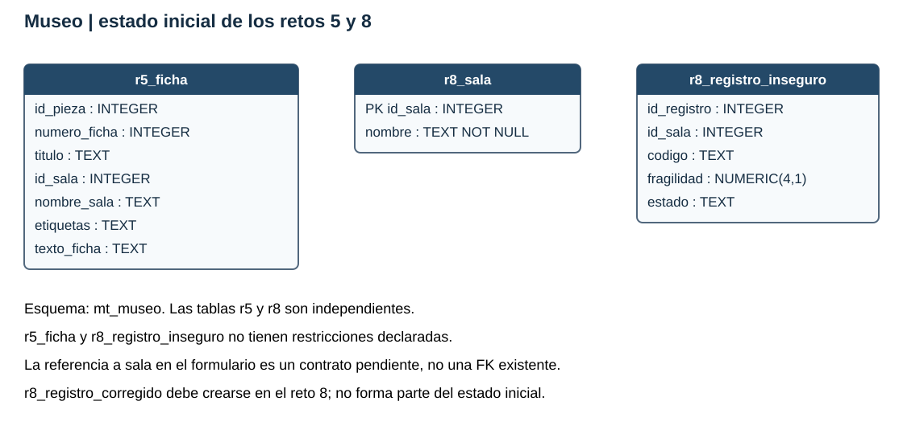
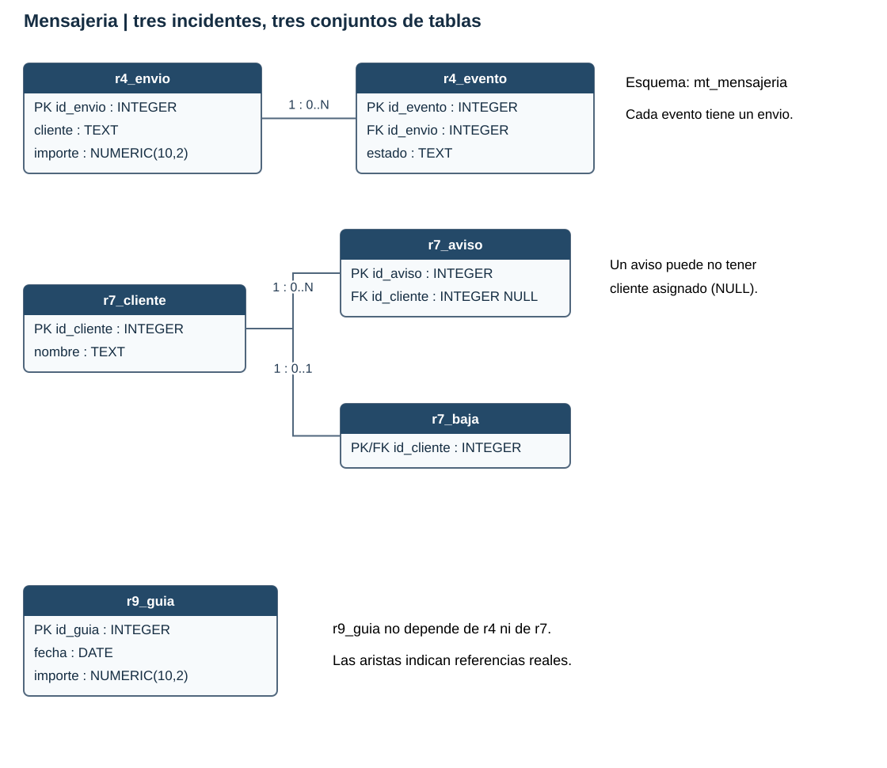
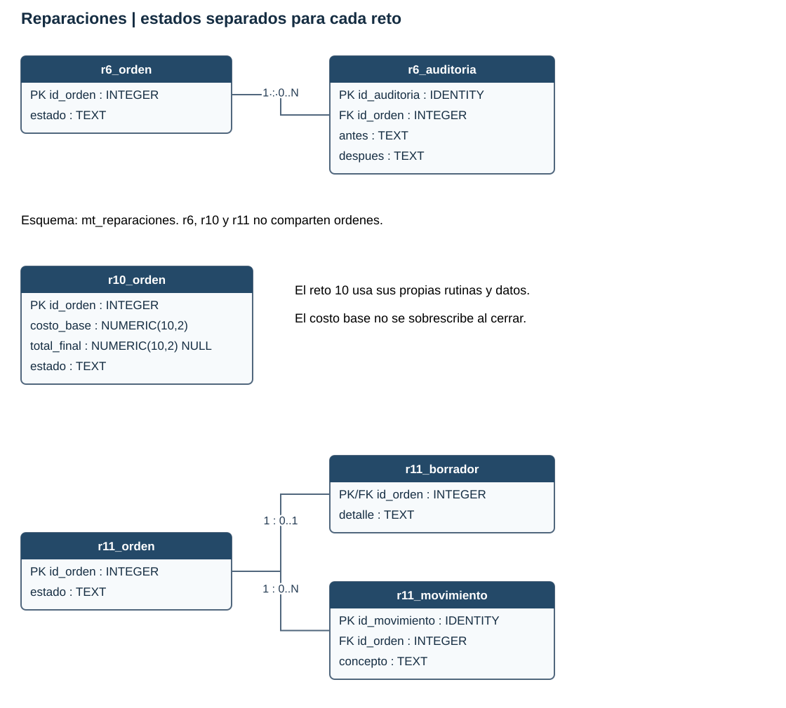
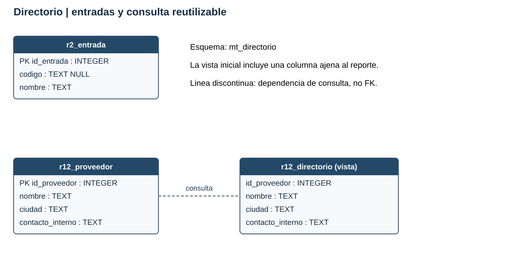
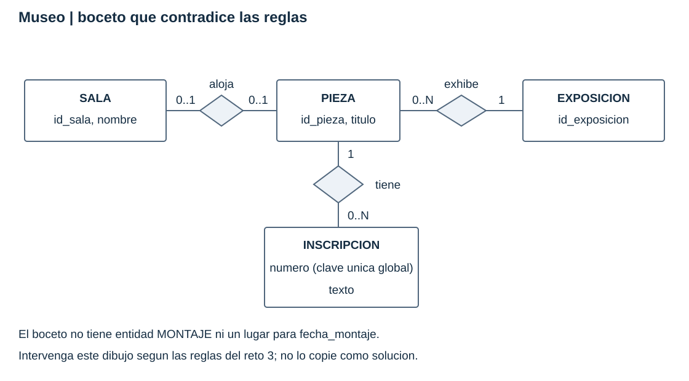

# Megataller — Clínica de datos

**Modelos de Datos · Repaso integral · Sin nota**

Hoy no vas a contestar otro examen: vas a intervenir cuatro sistemas pequeños que presentan fallos diferentes. Tu trabajo consiste en **detectar la causa, proponer una reparación y demostrar que funciona**, no en escribir todo desde cero.

## Cómo trabajar

- Trabajo **individual**, con apuntes, PostgreSQL y tu cliente habitual. Habrá discusión colectiva de hallazgos.
- Son **12 retos**, sin actividades adicionales. Alternan razonamiento escrito, diagramas y ejecución.
- Registra por reto: **hallazgo → reparación → evidencia**. Basta una explicación breve, un fragmento corregido o un diagrama intervenido; no se pide informe extenso.
- Predice el resultado antes de ejecutar. Si no coincide, conserva el contraejemplo y explica qué cambiaste.
- Los casos son independientes. Dentro de cada caso, los objetos llevan el número del reto: `r4_`, `r7_`, etc. No necesitas resolver un reto anterior para empezar otro.

### Antes de empezar

El profesor entregará una **base de práctica** preparada con [00_preparacion.sql](00_preparacion.sql). No uses bases con datos reales. Esa es toda la preparación necesaria para los doce retos.

Abre [01_fragmentos_estudiante.sql](01_fragmentos_estudiante.sql), pero **no lo ejecutes completo**: contiene defectos intencionales y marcas `__COMPLETAR__`. Ejecuta únicamente el fragmento que estés revisando, después de corregirlo.

Trabaja con la misma cuenta propietaria de los esquemas en todos los retos. Los ensayos que cambian datos se hacen con `BEGIN` y terminan con `ROLLBACK`; confirma únicamente la versión que se te indique. Si una sentencia falla dentro de una transacción, ejecuta `ROLLBACK` antes de continuar.

## Los cuatro expedientes

| Expediente | Situación | Material disponible |
|---|---|---|
| Museo | Un archivo necesita ordenar su inventario y proteger sus registros. | Fragmento conceptual, fichas repetidas y formulario permisivo. |
| Mensajería | Los reportes y listas no siempre representan lo que cree el operador. | Envíos, historial, avisos y guías con fechas fijas. |
| Reparaciones | Hay cambios cancelados, cálculos erróneos y cierres incompletos. | Órdenes separadas para cada incidente y código preparado. |
| Directorio | Se aceptan códigos incorrectos y el reporte incluye columnas innecesarias. | Entradas de prueba, proveedores ficticios y una vista por corregir. |

Los diagramas muestran **el estado inicial**, no una solución. `PK` identifica una clave primaria y `FK` una referencia. Los borradores señalados como inseguros no deben copiarse como diseño definitivo.

### Mapa del museo



### Mapa de mensajería



### Mapa de reparaciones



### Mapa del directorio



---

## Reto 1 · Una recomendación que confunde todo

**Expediente: museo · Intervención escrita**

El museo tiene una hoja de cálculo con inventarios duplicados. El coordinador propone:

> «El archivo es nuestro DBMS. Para moverlo a un disco más rápido hay que volver a dibujar las entidades. Si después renombramos una columna, las aplicaciones jamás necesitan cambios porque existe independencia lógica. Dejemos todas las decisiones de estructura al usuario que registra las piezas».

**Tu intervención:** sustituye esta recomendación por una nota técnica de hasta seis líneas. Distingue el archivo de datos del software que lo administra, conecta un dato del inventario con información útil y separa una decisión conceptual, una lógica y una física. Indica quién diseña y quién administra.

**Comprobación:** tu nota debe explicar por qué cambiar el almacenamiento puede no afectar las consultas y por qué renombrar una columna expuesta directamente sí puede romper una aplicación. No presentes la independencia como una garantía automática.

## Reto 2 · El lector de códigos deja pasar basura

**Expediente: directorio · Intervención SQL**

El contrato exige que, **después de quitar espacios exteriores y convertir a mayúsculas**, el código sea exactamente `PV-` seguido de cuatro dígitos. El nombre se presenta sin espacios exteriores y con iniciales en mayúscula. No debes modificar la tabla.

La tabla `mt_directorio.r2_entrada` contiene:

| id | Código recibido | Nombre |
|---|---|---|
| 1 | ` pv-0042 ` | `  ana lopez ` |
| 2 | `PV-1289` | `luis mora` |
| 3 | `xPV-0042` | `eva rios` |
| 4 | `PV-12` | `teo cruz` |
| 5 | `PV-99999` | `luz mesa` |
| 6 | `PV-ABCD` | `leo sol` |
| 7 | `NULL` SQL, no el texto `'NULL'` | `sin codigo` |

**Tu intervención:** repara el filtro y la presentación del bloque 2 del archivo de fragmentos.

**Comprobación:** solo deben aparecer los identificadores **1 y 2**, ordenados por identificador. Explica con un ejemplo por qué buscar una coincidencia dentro de la cadena no basta y qué sucede con el código nulo.

## Reto 3 · El dibujo no cuenta la misma historia

**Expediente: museo · Intervención gráfica**

Estas son las reglas acordadas:

- Una sala puede estar vacía o albergar varias piezas. Cada pieza está asignada a exactamente una sala.
- Una pieza puede participar en varias exposiciones y una exposición puede reunir varias piezas. Una misma pieza aparece como máximo una vez en cada exposición; se conserva su `fecha_montaje`.
- Cada pieza puede tener varias inscripciones; el `numero` de inscripción solo es único **dentro de su pieza**. La inscripción no existe sin ella.

El siguiente fragmento contradice esas reglas:



El boceto usa además `ubicacion = (sala, vitrina)` como atributo compuesto, `etiquetas = {materiales descriptivos}` como multivaluado y `antiguedad` como derivado de `fecha_creacion`. No confundas esos tipos con entidades por defecto.

**Tu intervención:** marca las tres reparaciones del fragmento: ubicación de piezas, montaje de exposiciones e identificación de inscripciones. Al margen, completa solo las claves y referencias de este borrador lógico:

```text
PIEZA(id_pieza, id_sala, titulo)
INSCRIPCION(id_pieza, numero, texto)
MONTAJE(id_pieza, id_exposicion, fecha_montaje)
```

**Comprobación:** tu diseño debe admitir dos inscripciones con `numero = 1` si pertenecen a piezas diferentes y rechazar un montaje duplicado de la misma pieza/exposición. Señala la entidad débil, la asociativa y dónde sacarías las etiquetas si se implementan como valores separados.

## Reto 4 · La factura crece al consultar el historial

**Expediente: mensajería · Intervención SQL**

Se necesita el **importe facturable por cliente**: sumar una sola vez cada envío que tenga al menos un evento `entregado` y mostrar solo clientes cuyo total alcance 150.

Los envíos de Ana cuestan 100 y 80. El historial contiene **dos** eventos `entregado` para el primero y uno para el segundo. Beto tiene un envío entregado de 70. Cora tiene uno de 50 todavía en ruta.

**Tu intervención:** ejecuta la consulta del bloque 4, identifica dónde aparece la multiplicación y repárala. Puedes cambiar la estrategia de consulta.

**Comprobación:** la única fila es **Ana, 180.00**. Justifica por qué `SUM(DISTINCT importe)` no sería una solución general si dos envíos distintos costaran lo mismo. Distingue el filtro de eventos del filtro sobre el total del cliente.

## Reto 5 · Cambiar el nombre de una sala exige tres ediciones

**Expediente: museo · Intervención escrita**

En `mt_museo.r5_ficha`, la clave de negocio prevista es `(id_pieza, numero_ficha)`:

| id_pieza | numero_ficha | titulo | id_sala | nombre_sala | etiquetas | texto_ficha |
|---|---|---|---|---|---|---|
| 10 | 1 | Mapa del puerto | 1 | Navegacion | papel;tinta | Anverso |
| 10 | 2 | Mapa del puerto | 1 | Navegacion | papel;tinta | Reverso |
| 20 | 1 | Brujula de viaje | 1 | Navegacion | metal | Base |

Reglas: `id_pieza` determina título, sala y conjunto de etiquetas; `id_sala` determina el nombre de sala; la clave completa determina el texto de cada ficha. Cada etiqueta debe poder consultarse como un valor separado. No supongas otras dependencias a partir de estas tres filas.

**Tu intervención:** escribe una descomposición relacional con claves que permita cambiar una sola vez el nombre de sala y conservar las fichas y etiquetas sin listas separadas por `;`. Acompáñala con las dependencias que motivan cada separación.

**Comprobación:** explica qué reparación corresponde a 1FN, cuál elimina una dependencia parcial y cuál elimina una transitiva. Reconstruye verbalmente la ficha `(10, 2)` para comprobar que no perdiste su texto.

## Reto 6 · Hay auditoría, pero el cambio nunca ocurrió

**Expediente: reparaciones · Intervención SQL**

En `r6_orden`, la orden 1 está `abierta`. Al intentar cerrarla, el sistema escribe una auditoría, pero la orden sigue igual. El trigger inicial es `BEFORE UPDATE` y su función usa:

```sql
INSERT INTO mt_reparaciones.r6_auditoria(id_orden, antes, despues)
VALUES (NEW.id_orden, NEW.estado, NEW.estado);
RETURN NULL;
```

**Tu intervención:** ensaya el bloque 6 con `BEGIN`/`ROLLBACK`. Repara la función y el trigger para auditar **después** del cambio, registrar estado anterior y nuevo y no generar entradas cuando se vuelve a asignar el mismo estado.

**Comprobación:** en una prueba limpia, cerrar la orden 1 deja estado `cerrada` y una auditoría `abierta → cerrada`. Repetir la asignación no agrega otra auditoría. Termina con `ROLLBACK` para no conservar la prueba. Explica por qué `RETURN NULL` cancelaba el cambio en el trigger original y por qué el retorno no controla el cambio en un trigger `AFTER`.

## Reto 7 · Nadie aparece en la lista de pendientes

**Expediente: mensajería · Intervención SQL y conjuntos**

Clientes: `1 Ada`, `2 Bruno`, `3 Celia`, `4 Dario`. Los avisos apuntan a `1, 1, 3, NULL`; las bajas son `3, 4`. El `NULL` representa un aviso aún no asignado, no un cliente desconocido que debas inventar.

El bloque 7 busca **clientes sin aviso**, pero no devuelve filas. Las bajas no intervienen en esa primera consulta.

**Tu intervención:**

1. Repara la consulta sin borrar filas ni sustituir el `NULL` de los datos. Relaciona tu solución con la diferencia entre el conjunto de clientes y la proyección de clientes con aviso.
2. Para la discusión, toma `A = {1, 3}` y `B = {3, 4}` y escribe los resultados de `A UNION B`, `A INTERSECT B` y `A EXCEPT B`. Explica qué pasaría con el duplicado `1` al usar `UNION ALL`.

**Comprobación:** la consulta de pendientes devuelve **2 Bruno y 4 Dario**. Razona usando la lógica de `NULL`, no diciendo que «PostgreSQL se equivoca».

## Reto 8 · Un formulario sin contrato

**Expediente: museo · Intervención DDL**

El borrador `r8_registro_inseguro` aceptó una sala inexistente, código nulo y fragilidad negativa. No necesitas reparar esa fila: debes completar la nueva tabla `r8_registro_corregido`.

Contrato:

- `id_registro` identifica de forma única y obligatoria cada registro.
- `id_sala` es obligatorio y referencia una fila de `r8_sala`.
- `codigo` es obligatorio y no puede repetirse.
- `fragilidad` es `NUMERIC(4,1)`, obligatoria y está entre 0 y 10, incluidos.
- `estado` es obligatorio, solo admite `catalogada` o `prestada` y toma `catalogada` si se omite.

**Tu intervención:** completa el DDL del bloque 8 y ensáyalo con una inserción válida que omita `estado` y dos inválidas: una con sala 999 y otra con fragilidad nula. Registra el motivo de cada rechazo. No uses triggers para sustituir restricciones.

**Comprobación:** la inserción válida recibe el estado previsto; ambas inválidas fallan. Distingue omitir una columna de proporcionarle explícitamente `NULL`. Para ensayar varios rechazos, usa transacciones separadas o `SAVEPOINT` y `ROLLBACK TO SAVEPOINT`; un error no se resuelve simplemente ejecutando el siguiente `INSERT`.

## Reto 9 · Marzo no identifica un año

**Expediente: mensajería · Intervención SQL y plan**

El informe debe mostrar días de **marzo de 2026** cuyo **importe total diario** supere 100, con fecha presentada como `DD/MM` y total redondeado a dos decimales. El bloque 9 usa una CTE, pero calcula promedios y selecciona marzo de cualquier año.

Datos relevantes:

| Fecha | Importes de las guías |
|---|---|
| 2026-03-01 | 80 |
| 2026-03-02 | 60 y 60 |
| 2026-03-03 | 110 |
| 2025-03-02 | 999 |
| 2026-04-01 | 200 |

**Tu intervención:** repara el informe y escribe una versión equivalente usando una tabla derivada. Conserva el orden cronológico por fecha, no por el texto presentado.

**Comprobación:** ambas versiones devuelven **02/03, 120.00** y **03/03, 110.00**. Examina `EXPLAIN` de un filtro por intervalo sobre `r9_guia.fecha`, crea un índice para esa columna y vuelve a examinarlo. Registra lo que ocurrió realmente: con seis filas es perfectamente válido que continúe el recorrido secuencial. Explica una ventaja de filtrar mediante un intervalo de fechas respecto a extraer únicamente el mes.

## Reto 10 · Un descuento que nunca descuenta

**Expediente: reparaciones · Intervención PL/pgSQL**

La orden 1 tiene costo base 200 y está abierta. La función preparada divide dos enteros antes de aplicar el descuento. El procedimiento tiene listos la búsqueda y el control de orden inexistente o cerrada; falta su actualización.

**Tu intervención:** repara `r10_neto(costo, descuento)` para aceptar costo no negativo y porcentaje entero de 0 a 100; rechazar explícitamente entradas nulas o fuera del contrato; y devolver el neto redondeado. Completa el único `UPDATE` de `r10_cerrar` para guardar el resultado y cerrar solo la orden recibida, sin alterar el costo base.

**Comprobación:** prueba la función con costo 200 y descuentos 15, 0 y 100; después con un argumento inválido. Dentro de una transacción llama al procedimiento para la orden 1 con 15 y revisa que la orden 2 no cambió. Una segunda llamada sobre la orden cerrada debe fallar. Termina la prueba con `ROLLBACK`; si provocaste un error, esa transacción ya requiere reversión.

Explica qué parte calcula un valor y cuál produce un efecto persistente, y por qué una se usa en `SELECT` y la otra con `CALL`. No agregues `COMMIT` dentro del procedimiento.

## Reto 11 · Cerrar una orden no es editar tres pantallas

**Expediente: reparaciones · Intervención transaccional**

Para cerrar la orden 7 se deben registrar un movimiento `cierre`, cambiar su estado a `cerrada` y eliminar su borrador. La orden 8 está abierta, tiene su propio borrador y **no debe cambiar**.

El borrador del bloque 11 confirma antes de terminar y tiene dos sentencias sin filtro.

**Tu intervención:** conviértelo en una sola transacción que afecte exclusivamente a la orden 7. Ensáyala primero con `ROLLBACK`, verifica que todo vuelve al estado inicial y luego ejecuta la versión con `COMMIT` una sola vez.

**Comprobación:** al final hay una orden 7 cerrada, un único movimiento suyo y ningún borrador suyo. La orden 8 sigue abierta y conserva su borrador. Explica qué debe hacer el cliente si falla la última sentencia y conecta este cierre con atomicidad, consistencia, aislamiento y durabilidad; la reversión comprueba atomicidad, **no demuestra por sí sola las cuatro propiedades**.

## Reto 12 · Una vista no es una copia congelada

**Expediente: directorio · Intervención sobre una vista**

El reporte del directorio necesita una consulta reutilizable con tres columnas. La vista inicial usa `SELECT *` e incluye `contacto_interno`, que no forma parte del reporte. Un compañero propone copiar las filas a otra tabla para evitar repetir la consulta.

Contrato final:

- La vista `mt_directorio.r12_directorio` devuelve **exactamente** `id_proveedor`, `nombre` y `ciudad`.
- Sus resultados reflejan los datos actuales de `r12_proveedor`, sin copiar filas a otra tabla.
- `contacto_interno` permanece intacto en la tabla base.

**Tu intervención:** reemplaza la vista defectuosa y consulta sus dos filas, ordenadas por identificador. Para retirar una columna de una vista existente, elimina únicamente esa vista con `DROP VIEW` y vuelve a crearla con `CREATE VIEW`, dentro de una transacción y sin `CASCADE`; no borres la tabla base.

**Comprobación:** después de confirmar la reparación de la vista, ensaya el bloque 12 con `BEGIN`: cambia a `Armenia` la ciudad del proveedor 1 en la tabla base y consulta la vista. Termina con `ROLLBACK` y vuelve a consultar. Debes observar **Pasto → Armenia → Pasto**, mientras el proveedor 2 conserva `Tunja`. Comprueba también que ambos contactos originales siguen en la tabla base.

Explica brevemente por qué esta vista ordinaria no es una copia independiente de los resultados y por qué quitar una columna de su consulta no elimina esa columna de la tabla.

---

## Puesta en común

Sin agregar ejercicios ni entregar un informe nuevo, comparte un hallazgo de tu registro:

- Un resultado que parecía correcto hasta que apareció un contraejemplo.
- Una decisión de diseño que evitó corregir datos repetidos.
- Una diferencia entre «la consulta funciona» y «la operación cumple su contrato».

Usa tu registro para identificar qué necesitas repasar. El propósito no es acumular sentencias, sino justificar por qué el arreglo funciona también en los límites.
