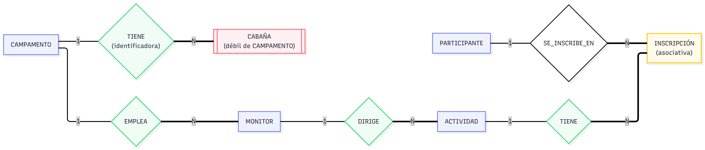

# Práctica — Del E-R al modelo relacional
**Curso:** Modelo de Datos &nbsp;|&nbsp; **Clase 10** &nbsp;|&nbsp; **25 de agosto de 2026**

> En esta práctica **no dibujas** un diagrama E-R.
> Recibes el E-R ya construido y tu tarea es convertirlo en un esquema relacional.

---

## Instrucciones

1. Lee el E-R completo antes de comenzar.
2. Aplica cada regla de conversión en el orden que corresponda.
3. Escribe el esquema relacional usando la notación del curso:
   `TABLA(col1 [PK], col2, col3 [FK → OTRA_TABLA])`
4. Para cada tabla que generes, indica **qué regla** te llevó a crearla.
5. Las preguntas de análisis al final son obligatorias.

---

## E-R de entrada — Sistema de gestión de un campamento de verano

### Entidades y sus atributos

| Entidad | Tipo | Atributos |
|---------|------|-----------|
| `CAMPAMENTO` | Fuerte | `cod_campamento` [clave], `nombre`, `ciudad`, `dirección` [compuesto: calle, número], `teléfono`, `email` |
| `CABAÑA` | **Débil** de CAMPAMENTO | `num_cabaña` [discriminante], `nombre_cabaña`, `capacidad_personas`, `servicios` [multivaluado: electricidad, agua_caliente, wifi, calefacción] |
| `MONITOR` | Fuerte | `cod_monitor` [clave], `nombre_completo` [compuesto: primer_nombre, apellidos], `teléfono`, `especialidades` [multivaluado: deportes, música, arte, naturaleza, idiomas] |
| `PARTICIPANTE` | Fuerte | `num_participante` [clave], `nombre_completo` [compuesto: primer_nombre, apellidos], `fecha_nacimiento`, `edad` [**derivado**], `email_tutor`, `nombre_tutor`, `alergias` [multivaluado, **opcional** — puede no tener ninguna] |
| `ACTIVIDAD` | Fuerte | `cod_actividad` [clave], `nombre`, `descripción`, `duración_minutos`, `nivel` (básico / intermedio / avanzado) |
| `INSCRIPCIÓN` | **Asociativa** (PARTICIPANTE × ACTIVIDAD) | `fecha_inscripcion`, `precio_pagado`, `estado` (confirmada / cancelada / completada) |

---

### Relaciones

| Relación | Cardinalidad | Participación |
|----------|-------------|---------------|
| CAMPAMENTO **TIENE** CABAÑA | 1:N — **identificadora** | CABAÑA: total | CAMPAMENTO: parcial |
| CAMPAMENTO **EMPLEA** MONITOR | 1:N | MONITOR: total | CAMPAMENTO: parcial |
| MONITOR **DIRIGE** ACTIVIDAD | 1:N | ACTIVIDAD: total | MONITOR: parcial |
| PARTICIPANTE ↔ ACTIVIDAD → **INSCRIPCIÓN** | M:N — asociativa | PARTICIPANTE: parcial | ACTIVIDAD: parcial |

---

### Diagrama E-R



---

## Tarea

Convierte el E-R anterior en un esquema relacional completo.

Para cada tabla que produzcas, indica:
- Nombre de la tabla
- Columnas con sus marcas `[PK]`, `[FK → TABLA]`, `?` (nullable) según corresponda
- La regla de conversión que aplicaste (R1 a R9)

Usa este formato:

```
NOMBRE_TABLA(columna1 [marca], columna2, columna3 [marca])
Regla aplicada: R?
```

---

## Preguntas de análisis

Responde después de construir el esquema.

1. ¿Cuántas tablas generó el E-R en total? ¿Cuántas venían directamente de entidades fuertes y cuántas se generaron por otras reglas?

2. La `dirección` de CAMPAMENTO era un atributo compuesto con sub-atributos `calle` y `número`. ¿Cómo quedó representada en la tabla? ¿Por qué no se crea una tabla separada para la dirección?

3. ¿Cuántas tablas requirió MONITOR para representar todos sus datos? ¿Qué atributo generó una tabla adicional?

4. `edad` de PARTICIPANTE es un atributo derivado. ¿Por qué no aparece como columna? ¿Cómo se obtendría su valor al hacer una consulta?

5. La tabla CABAÑA tiene una PK compuesta. Escríbela explícitamente. ¿Por qué no alcanza con `num_cabaña` solo como PK?

6. La tabla INSCRIPCIÓN tiene también una PK compuesta. ¿Qué columnas la forman? ¿Qué pasa si un mismo participante quiere inscribirse dos veces en la misma actividad? ¿El modelo lo permite o lo impide?

7. Analiza la FK `cod_campamento` en la tabla MONITOR. ¿Debería permitir NULL (ser nullable)? Justifica con base en la participación de la relación CAMPAMENTO–MONITOR.

8. ¿Qué columna en la tabla ACTIVIDAD viene de la relación MONITOR–ACTIVIDAD? ¿Por qué va ahí y no en MONITOR?
