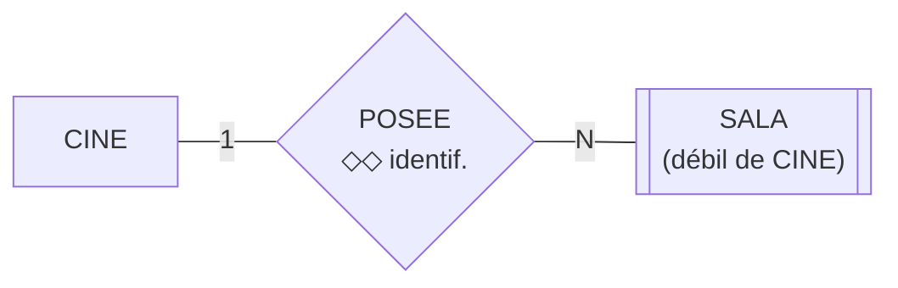
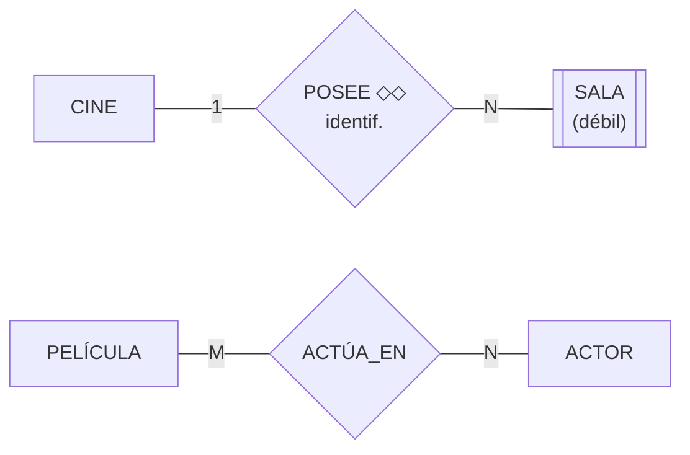
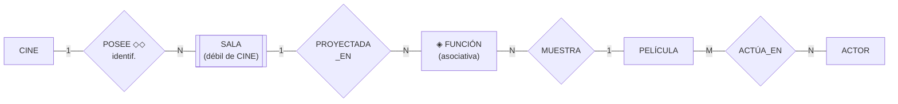
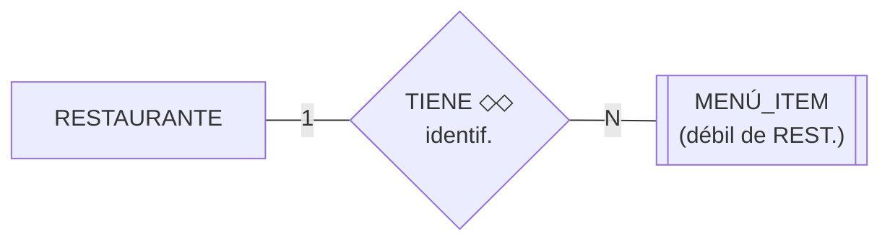
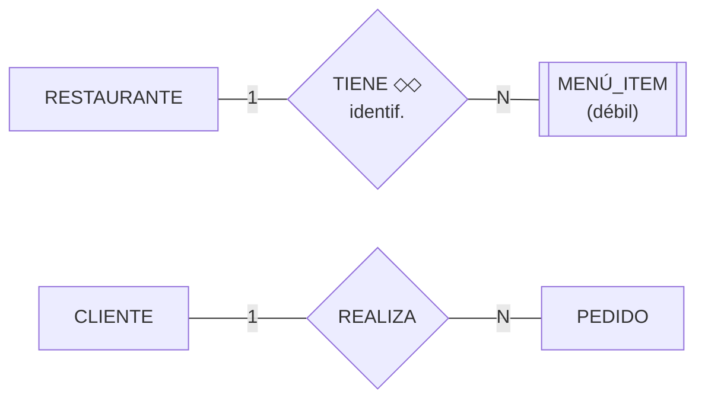
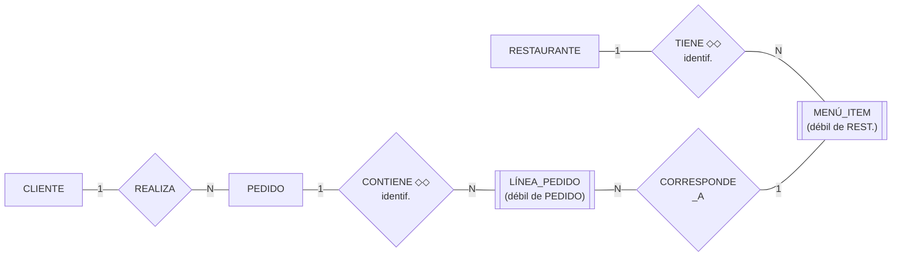
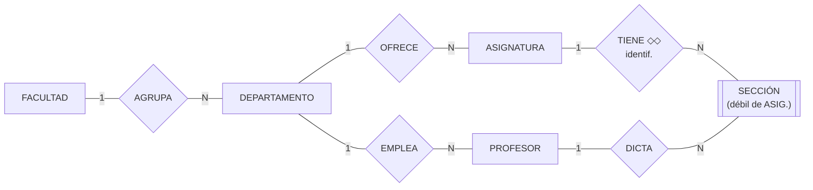
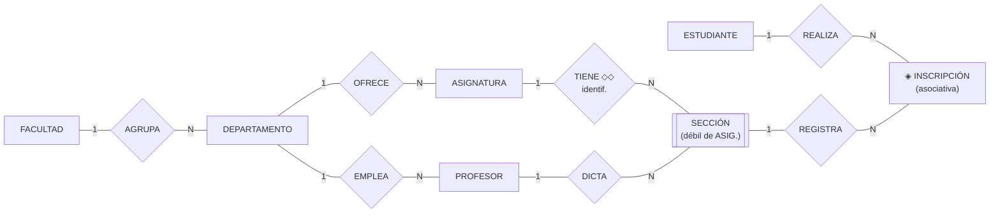

# Ejercicio guiado — Construcción de diagramas E-R en draw.io
**Clase 7 | Notación Chen | ~20 min por dominio · ~60 min los tres**

---

## Cómo usar esta guía

El diagrama **crece en cada etapa** — cada etapa muestra el estado acumulado.
Dibuja en draw.io mientras avanzas; el diagrama Mermaid es la referencia del resultado esperado.

**Sugerencia de uso:**
- Clase 7 (demo draw.io, 15 min) → Dominio A, etapas 1 y 2
- Clase 8 (práctica integradora, 1 h) → un dominio completo a elección de los estudiantes

**Referencia de shapes — librería "Entity Relation" en draw.io:**

| Shape | Figura Chen |
|-------|-------------|
| `Entity` | Rectángulo — entidad fuerte |
| `Weak Entity` | Rectángulo doble — entidad débil |
| `Relationship` | Diamante — relación |
| `Identifying Relationship` | Diamante doble — relación identificadora |
| `Attribute` | Óvalo — atributo simple |
| `Key Attribute` | Óvalo subrayado — clave primaria |
| `Partial Key` | Óvalo punteado — discriminador |
| `Derived Attribute` | Óvalo punteado — atributo derivado |
| `Multivalued Attribute` | Óvalo doble — atributo multivaluado |

---

## DOMINIO A — Sistema de cine 🎬

### Enunciado

> Una cadena de cines gestiona sus salas y funciones. Cada cine tiene nombre y dirección.
> Las salas se identifican por número dentro del cine y tienen capacidad y tipo (normal o VIP).
> Las películas tienen título, año y una calificación promedio calculada a partir de las reseñas
> registradas en el sistema. Un actor puede participar en muchas películas; de cada participación
> se registra el personaje interpretado. Cada función corresponde a una sala y una película,
> con fecha, hora y precio base.

---

### Etapa A.1 — Entidad débil (7 min)

**Agregar en draw.io:**
1. `Entity` → **CINE** · conectar: `Key Attribute` → `id_cine`, `Attribute` → `nombre`, `Attribute` → `dirección`
2. `Weak Entity` → **SALA** · conectar: `Partial Key` → `num_sala`, `Attribute` → `capacidad`, `Attribute` → `tipo`
3. `Identifying Relationship` → **POSEE** entre CINE y SALA
4. Línea desde CINE a POSEE → etiquetar **1** · línea desde POSEE a SALA → etiquetar **N**
5. Marcar participación: línea **doble** desde SALA → POSEE (total); línea **simple** desde CINE → POSEE (parcial)

**Preguntas:**
> - ¿Por qué la sala número 5 no identifica a una sala específica sin saber el cine?
> - ¿Qué pasaría con las SALAS si se elimina un CINE del sistema?
> - ¿Por qué la participación de SALA es total y la de CINE es parcial?

**Diagrama tras la etapa A.1:**

---

### Etapa A.2 — M:N con atributo propio (8 min)

**Agregar en draw.io:**
1. `Entity` → **PELÍCULA** · conectar: `Key Attribute` → `id_pelicula`, `Attribute` → `título`, `Attribute` → `año`, `Derived Attribute` → `calificacion_promedio`
2. `Entity` → **ACTOR** · conectar: `Key Attribute` → `id_actor`, `Attribute` → `nombre`, `Attribute` → `nacionalidad`
3. `Relationship` → **ACTÚA_EN** entre PELÍCULA y ACTOR
4. `Attribute` → `personaje` conectado al diamante **ACTÚA_EN** (no a las entidades)
5. Etiquetar aristas: **M** del lado de PELÍCULA, **N** del lado de ACTOR

**Preguntas:**
> - ¿Por qué `calificacion_promedio` es derivado? ¿Podría almacenarse directamente?
> - ¿Dónde va el atributo `personaje`? ¿Por qué no puede ir en ACTOR ni en PELÍCULA?
> - Si una película tuviera exactamente un director, ¿cómo cambiaría la cardinalidad?

**Diagrama tras la etapa A.2:**

---

### Etapa A.3 — Entidad asociativa (5 min)

**Agregar en draw.io:**
1. `Entity` → **FUNCIÓN** (marcarla como asociativa: diamante dentro del rectángulo en draw.io)
2. Conectar: `Key Attribute` → `id_funcion`, `Attribute` → `fecha`, `Attribute` → `hora`, `Attribute` → `precio_base`
3. `Relationship` → **PROYECTADA_EN** entre FUNCIÓN y SALA · aristas: **N** desde FUNCIÓN, **1** desde SALA
4. `Relationship` → **MUESTRA** entre FUNCIÓN y PELÍCULA · aristas: **N** desde FUNCIÓN, **1** desde PELÍCULA

**Preguntas:**
> - ¿Por qué FUNCIÓN es una entidad asociativa y no solo una relación con atributos?
> - ¿Cuántas funciones puede tener una sala en un día? ¿Cambia la cardinalidad eso?
> - ¿Podría existir una FUNCIÓN sin SALA o sin PELÍCULA? ¿Qué tipo de participación es?

**Diagrama final Dominio A:**

---

## DOMINIO B — Sistema de pedidos de comida 🍕

### Enunciado

> Una plataforma de delivery registra restaurantes y sus menús. Cada restaurante tiene nombre
> y dirección. Los ítems del menú se identifican por un código dentro del restaurante y tienen
> nombre, precio y categoría. Los clientes tienen nombre, una dirección de entrega compuesta
> por calle y ciudad, y pueden registrar varios teléfonos. Un cliente hace pedidos; cada pedido
> tiene fecha, estado y un total que se calcula a partir de sus líneas. Cada línea del pedido
> registra la cantidad y el precio unitario del ítem pedido, y se identifica por su número
> dentro del pedido.

---

### Etapa B.1 — Entidad débil (7 min)

**Agregar en draw.io:**
1. `Entity` → **RESTAURANTE** · `Key Attribute` → `id_rest`, `Attribute` → `nombre`, `Attribute` → `dirección`
2. `Weak Entity` → **MENÚ_ITEM** · `Partial Key` → `cod_item`, `Attribute` → `nombre_plato`, `Attribute` → `precio`, `Attribute` → `categoría`
3. `Identifying Relationship` → **TIENE** entre RESTAURANTE y MENÚ_ITEM
4. Aristas: **1** desde RESTAURANTE (parcial), **N** desde MENÚ_ITEM (total)

**Preguntas:**
> - Dos restaurantes distintos, ¿podrían tener un ítem con el mismo `cod_item`? ¿Qué implica eso?
> - ¿Cuál es la identificación completa de un MENÚ_ITEM en este modelo?
> - Si se elimina el restaurante, ¿qué ocurre con sus ítems de menú?

**Diagrama tras la etapa B.1:**

---

### Etapa B.2 — Atributos especiales + relación 1:N (8 min)

**Agregar en draw.io:**
1. `Entity` → **CLIENTE** · `Key Attribute` → `id_cliente`, `Attribute` → `nombre`
2. Agregar atributo **compuesto**: `Attribute` → `dirección_entrega` con sub-atributos `Attribute` → `calle` y `Attribute` → `ciudad`
3. `Multivalued Attribute` → `teléfonos` conectado a CLIENTE
4. `Entity` → **PEDIDO** · `Key Attribute` → `id_pedido`, `Attribute` → `fecha`, `Attribute` → `estado`, `Derived Attribute` → `total`
5. `Relationship` → **REALIZA** entre CLIENTE y PEDIDO · aristas: **1** parcial desde CLIENTE, **N** total desde PEDIDO

**Preguntas:**
> - ¿Por qué `teléfonos` es multivaluado? ¿Cómo se dibuja diferente a un atributo simple?
> - ¿De dónde se calcularía el `total` de un pedido? ¿Por qué es derivado?
> - La participación de CLIENTE en REALIZA: ¿un cliente puede existir sin haber pedido nunca?

**Diagrama tras la etapa B.2:**

---

### Etapa B.3 — Segunda entidad débil con dos relaciones (5 min)

**Agregar en draw.io:**
1. `Weak Entity` → **LÍNEA_PEDIDO** · `Partial Key` → `num_linea`, `Attribute` → `cantidad`, `Attribute` → `precio_unitario`
2. `Identifying Relationship` → **CONTIENE** entre PEDIDO y LÍNEA_PEDIDO · aristas: **1** (parcial desde PEDIDO), **N** (total desde LÍNEA_PEDIDO)
3. `Relationship` → **CORRESPONDE_A** entre LÍNEA_PEDIDO y MENÚ_ITEM · aristas: **N** desde LÍNEA_PEDIDO (total), **1** desde MENÚ_ITEM (parcial)

**Preguntas:**
> - LÍNEA_PEDIDO tiene dos relaciones: ¿cuál es identificadora y cuál es regular? ¿Cómo se distinguen en el diagrama?
> - ¿Podría modelarse LÍNEA_PEDIDO como entidad asociativa (PEDIDO × MENÚ_ITEM)? ¿Qué diferencia habría?
> - ¿Puede existir un ítem de menú que nunca haya sido pedido? ¿Cómo se refleja eso?

**Diagrama final Dominio B:**

---

## DOMINIO C — Sistema universitario ampliado 🎓

### Enunciado

> Una universidad organiza sus departamentos dentro de facultades. Cada departamento
> emplea profesores y ofrece asignaturas. Las secciones de una asignatura se identifican
> por número dentro de esa asignatura y tienen horario y aula asignada. Un profesor puede
> dictar varias secciones. Los estudiantes se inscriben en secciones; de cada inscripción se
> registra la fecha, la nota final y el estado (activa, retirada o aprobada). El promedio
> académico del estudiante se calcula automáticamente a partir de sus notas registradas.

---

### Etapa C.1 — Cadena de relaciones 1:N (7 min)

**Agregar en draw.io:**
1. `Entity` → **FACULTAD** · `Key Attribute` → `id_facultad`, `Attribute` → `nombre`
2. `Entity` → **DEPARTAMENTO** · `Key Attribute` → `id_depto`, `Attribute` → `nombre`, `Attribute` → `presupuesto`
3. `Entity` → **PROFESOR** · `Key Attribute` → `id_prof`, `Attribute` → `nombre`, `Attribute` → `email`
4. `Relationship` → **AGRUPA** entre FACULTAD y DEPARTAMENTO · aristas: **1** parcial, **N** total desde DEPARTAMENTO
5. `Relationship` → **EMPLEA** entre DEPARTAMENTO y PROFESOR · aristas: **1** parcial, **N** total desde PROFESOR

**Preguntas:**
> - ¿Puede existir un DEPARTAMENTO sin FACULTAD? ¿Cómo cambia la participación si no?
> - ¿Puede un profesor pertenecer a dos departamentos simultáneamente? ¿Cómo afectaría el modelo?
> - ¿Qué cardinalidad es FACULTAD → DEPARTAMENTO? ¿Y DEPARTAMENTO → PROFESOR?

**Diagrama tras la etapa C.1:**

---

### Etapa C.2 — Entidad débil con dos relaciones (8 min)

**Agregar en draw.io:**
1. `Entity` → **ASIGNATURA** · `Key Attribute` → `id_asig`, `Attribute` → `nombre`, `Attribute` → `créditos`
2. `Relationship` → **OFRECE** entre DEPARTAMENTO y ASIGNATURA · aristas: **1** (parcial), **N** (total desde ASIGNATURA)
3. `Weak Entity` → **SECCIÓN** · `Partial Key` → `num_seccion`, `Attribute` → `horario`, `Attribute` → `aula`
4. `Identifying Relationship` → **TIENE** entre ASIGNATURA y SECCIÓN · aristas: **1** parcial, **N** total
5. `Relationship` → **DICTA** entre PROFESOR y SECCIÓN · aristas: **1** parcial, **N** total desde SECCIÓN

**Preguntas:**
> - ¿Por qué la sección 01 de "Bases de Datos" es diferente a la sección 01 de "Cálculo"?
> - SECCIÓN tiene dos relaciones: TIENE (identificadora) y DICTA (regular). ¿Cómo se distinguen en el diagrama?
> - ¿Puede existir una sección sin profesor asignado? ¿Cómo se modelaría eso?

**Diagrama tras la etapa C.2:**

---

### Etapa C.3 — Entidad asociativa + atributo derivado (5 min)

**Agregar en draw.io:**
1. `Entity` → **ESTUDIANTE** · `Key Attribute` → `id_estudiante`, `Attribute` → `nombre`, `Attribute` → `carné`, `Derived Attribute` → `promedio`
2. `Entity` (asociativa) → **INSCRIPCIÓN** · `Key Attribute` → `id_inscripcion`, `Attribute` → `fecha`, `Attribute` → `nota_final`, `Attribute` → `estado`
3. `Relationship` → **REALIZA** entre ESTUDIANTE e INSCRIPCIÓN · aristas: **1** parcial, **N** total desde INSCRIPCIÓN
4. `Relationship` → **REGISTRA** entre SECCIÓN e INSCRIPCIÓN · aristas: **1** parcial, **N** total desde INSCRIPCIÓN

**Preguntas:**
> - `promedio` del estudiante: ¿de qué atributos se calcula? ¿Dónde están almacenados esos datos?
> - ¿Por qué INSCRIPCIÓN es entidad asociativa? ¿Qué relación M:N resuelve?
> - ¿Tiene sentido que un estudiante esté inscrito dos veces en la misma sección al mismo tiempo?

**Diagrama final Dominio C:**

---

## Checklist de verificación final

Al terminar un dominio, revisar punto por punto:

| | Elemento | Verificar |
|---|----------|-----------|
| ☐ | Entidades débiles | Rectángulo **doble** y su relación identificadora con diamante **doble** |
| ☐ | Discriminadores | Óvalo **punteado** (shape `Partial Key`) |
| ☐ | Entidades asociativas | Anotadas con ◈ o usando diamante dentro de rectángulo |
| ☐ | Cardinalidades | **1** y **N** (o **M**) marcados sobre cada arista |
| ☐ | Participación total | Línea **doble** desde la entidad hacia el diamante |
| ☐ | Participación parcial | Línea **simple** |
| ☐ | Atributos derivados | Óvalo **punteado** — confirmar que **no se almacena** directamente |
| ☐ | Atributos multivaluados | Óvalo **doble** (shape `Multivalued Attribute`) |
